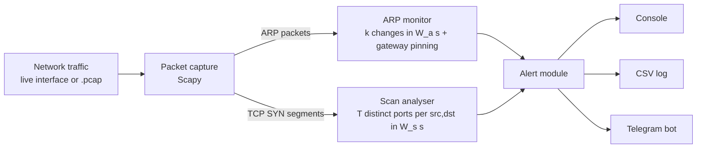
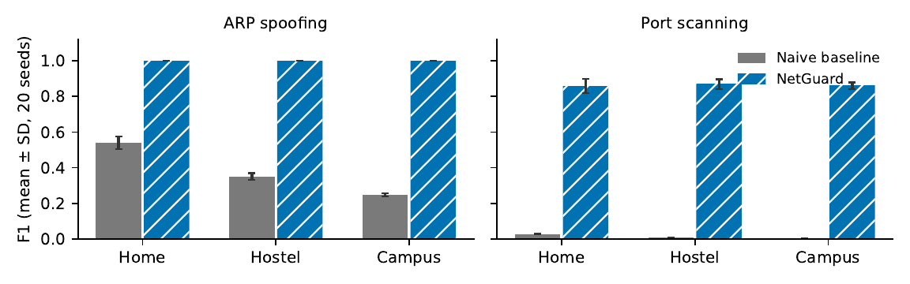
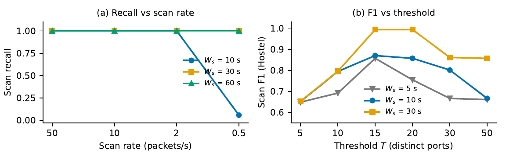
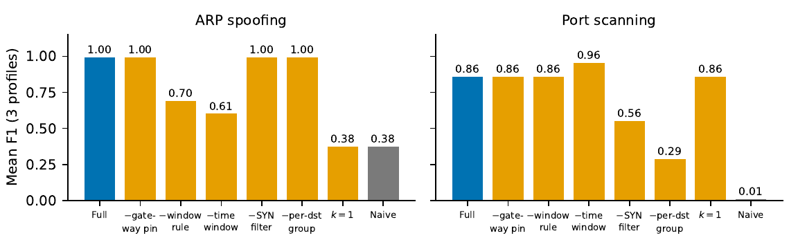

# 🛡️ NetGuard — A Lightweight Network Intrusion Detection System

NetGuard watches a local network (home Wi‑Fi, hostel/PG LAN, lab) and raises an alert when it sees an
**ARP spoofing** attack or a **TCP port scan**. It is passive (it only listens), runs on an ordinary laptop,
needs no change to any other device, and can push alerts to your phone through a **Telegram bot**.

  

> **Course project — Computer Networks.** The accompanying research paper (Springer Nature template) is based on the
> experiments in this repository.

## Features

- **ARP spoofing detection** — windowed IP→MAC change rule + pinning of the gateway's MAC address
- **Port‑scan detection** — distinct ports per (source, destination) in a sliding window, SYN‑only
- **Real‑time alerts** — console, CSV log file, and Telegram notification
- **Live or offline** — sniff an interface, or analyse a `.pcap` file with exactly the same code
- **O(1) work per packet**, roughly 30,000–40,000 packets/s end‑to‑end (including Scapy decoding) on the test machine
- **Reproducible evaluation** — labelled synthetic traffic generator, ablation study, statistical tests, figures
- **17 automated tests** (`pytest`)

## How it works



| Detector | Rule | Default |
|---|---|---|
| ARP windowed change | MAC of one IP changes **k** times within **W_a** | k = 2, W_a = 10 s |
| ARP gateway pinning | first MAC seen for the gateway is trusted; any other MAC claiming it alerts at once | `--gateway IP` |
| Port scan | **T** distinct ports of one destination, from one source, within **W_s** (SYN‑only) | T = 15, W_s = 10 s |

More detail and the reasoning behind each design choice: [`docs/how_it_works.md`](docs/how_it_works.md).

## Quick start

```bash
git clone <your-repo-url> && cd netguard
python3 -m venv venv && source venv/bin/activate        # Windows: venv\Scripts\activate
pip install -r requirements.txt
```
*Windows:* install [Npcap](https://npcap.com) once (needed by Scapy for packet capture). *Linux/macOS:* no extra step.

### 1. Try it without any network — the demo capture

```bash
python3 netguard.py --pcap demo/demo.pcap --gateway 10.0.0.1
```
`demo/demo.pcap` is a 3‑minute capture with normal browsing, one *harmless* NIC replacement, one *harmless* burst to a
file server, a fast scan, an ARP spoofing of the gateway and a slow scan. Expected output
([`demo/expected_output.txt`](demo/expected_output.txt)):

```
ALERT PORT_SCAN src=10.0.0.66 15 distinct ports on 10.0.0.20 in 10.0s
ALERT ARP_SPOOF src=10.0.0.1 gateway 10.0.0.1 claimed by bb:bb:bb:bb:bb:66, trusted aa:aa:aa:aa:aa:01
ALERT ARP_SPOOF src=10.0.0.1 gateway 10.0.0.1 claimed by bb:bb:bb:bb:bb:66, trusted aa:aa:aa:aa:aa:01
ALERT PORT_SCAN src=10.0.0.66 15 distinct ports on 10.0.0.20 in 10.0s
ALERT PORT_SCAN src=10.0.0.66 21 distinct ports on 10.0.0.20 in 10.0s
ALERT PORT_SCAN src=10.0.0.66 21 distinct ports on 10.0.0.20 in 10.0s
done: 6 alert(s)
```
The two harmless events raise **no** alert. A long attack produces one alert per cool‑down period (10 s), not one per packet.
Regenerate the capture with `python3 demo/make_demo_pcap.py`.

### 2. Live monitoring

```bash
sudo python3 netguard.py --live --iface eth0 --gateway 192.168.1.1 --log alerts.csv
```
(On Windows run the terminal as Administrator and omit `sudo`.) Press `Ctrl+C` to stop.

**Where to run it:** NetGuard is passive, so it sees broadcast frames and frames addressed to its own host. Run it on
the machine you want to protect, on the gateway, or on a host that receives mirrored traffic (SPAN port).

### 3. Telegram alerts

1. In Telegram open **@BotFather**, send `/newbot`, follow the steps and copy the **token**.
2. Send any message to your new bot, then open `https://api.telegram.org/bot<TOKEN>/getUpdates` in a browser and copy
   the number under `"chat":{"id": ...}`.
3. Set the two variables and add `--telegram`:

```bash
export NETGUARD_TOKEN="123456:ABC..."        # Windows (PowerShell): $env:NETGUARD_TOKEN="..."
export NETGUARD_CHAT_ID="123456789"
sudo -E python3 netguard.py --live --gateway 192.168.1.1 --telegram
```

### 4. Testing against real attacks (only on a network you own!)

Use two virtual machines on an isolated lab network, with NetGuard running on the victim:

```bash
nmap -sS -p 1-200 <victim-ip>                        # port scan  -> PORT_SCAN alert
sudo arpspoof -i eth0 -t <victim-ip> <gateway-ip>    # ARP spoofing (dsniff package) -> ARP_SPOOF alert
```

## Command‑line options

| Option | Meaning | Default |
|---|---|---|
| `--live` / `--pcap FILE` | sniff an interface / analyse a capture file | – |
| `--iface NAME` | interface for `--live` | system default |
| `--gateway IP` | gateway address to pin (enables gateway pinning) | off |
| `--k N` | MAC changes of one IP within the window that raise an alert | 2 |
| `--arp-window S` | ARP window W_a in seconds | 10 |
| `--threshold N` | distinct ports on one destination that raise an alert | 15 |
| `--scan-window S` | scan window W_s in seconds | 10 |
| `--log FILE` | append alerts to a CSV file | off |
| `--telegram` | send alerts to Telegram | off |

## Evaluation

Real attack captures with ground truth are scarce (public datasets such as CIC‑IDS2017 are flow‑based and contain no
ARP attacks), so NetGuard is evaluated on a **labelled synthetic traffic generator**
([`experiments/evaluate.py`](experiments/evaluate.py)): three network profiles (Home 6 hosts, Hostel 40, Campus 120),
600 s per run, 20 random seeds each — 60 runs, 180 ARP‑spoofing episodes and 480 port scans — including *hard negatives*
(P2P‑like hosts, bursts to one server, hosts that change or alternate MAC addresses).

| | NetGuard | Naive baseline* |
|---|---|---|
| ARP spoofing — episodes detected | **180 / 180** | 180 / 180 |
| ARP spoofing — false alarms | **0** | 69 / 223 / 491 (Home / Hostel / Campus) |
| ARP spoofing — F1 | **1.00** | 0.25 – 0.54 |
| Port scans detected | **367 / 480 (76.5 %)** | 480 / 480 |
| Port scan — false alarms | **3** (precision 0.992) | 5,645 – 132,860 per profile |
| Port scan — F1 | **0.86 – 0.87** | < 0.03 |

\* alert on any MAC change; count distinct (destination, port) pairs per source over the whole run, with no window,
no SYN filter and no grouping by destination — a deliberately weak baseline.



**Scan speed vs window** — every scan at 2, 10 and 50 packets/s is detected; stealth scans at 0.5 packets/s are
detected only with a longer window (5.8 % with W_s = 10 s, 100 % with W_s = 30 s, at the price of more false alarms).
Measured detection latency matches the model T/λ (0.31 s, 1.51 s and 7.6 s versus 0.30 s, 1.5 s and 7.5 s).



**Ablation** — removing one design element at a time (Wilcoxon signed‑rank tests, p < 0.001 for each effect described):



### Honest limitations

- The evaluation uses **synthetic** traffic; absolute scores (especially the perfect ARP score) are probably optimistic.
  Only the *relative* comparisons between variants are reliable. Evaluation on real captures is future work.
- Slow scans (≈ 0.5 packets/s) are missed with the default 10 s window.
- Passive, single vantage point: it sees only the traffic that reaches its interface. If it is started *during* an ARP
  attack, the wrong gateway MAC is pinned.
- No IPv6, UDP/ICMP scans, horizontal or distributed scans. It detects but does not block.
- Scapy decoding limits throughput (roughly 30,000–40,000 packets/s), so it is not meant for fast links.

### Reproduce everything

```bash
pip install -r requirements-experiments.txt
python3 -m pytest -q tests          # 17 tests
bash experiments/run_all.sh         # regenerates results/*.json and docs/figures/*.pdf (a few minutes)
python3 experiments/benchmark.py    # packets/second with Scapy decoding
```

## Project structure

```
netguard.py                 the tool: detectors, alerting, command-line interface
tests/                      pytest unit tests + end-to-end pcap test
demo/                       demo capture, its generator, expected output
experiments/                traffic generator, evaluation, ablation, statistics, figures, benchmark
results/                    raw numbers behind the paper/README (JSON)
docs/                       how_it_works.md and figures
```

## Responsible use

Only monitor networks you own or are explicitly authorised to monitor, and only run the attack tools of section 4 in
an isolated lab. NetGuard contains **no** attack code.

## Acknowledgements

This project was developed with the assistance of an AI model (Claude, by Anthropic) for code, experiments and
documentation. The author is responsible for understanding, running and presenting it.

## License

MIT — see [`LICENSE`](LICENSE).
